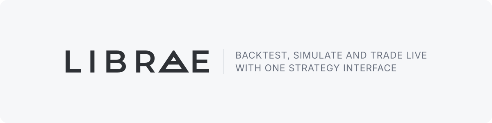

<div align="center">

<picture>
  <source media="(prefers-color-scheme: dark)" srcset="https://raw.githubusercontent.com/awwesomeman/librae/main/docs/assets/librae_banner_dark.png">
  
</picture>

</div>

<p align="center">
    <a href="https://github.com/awwesomeman/librae/actions/workflows/core-tests.yml" title="test workflow">
        
    </a>
    <a href="https://github.com/awwesomeman/librae/blob/main/pyproject.toml" title="Python versions">
        
    </a>
    <a href="https://github.com/awwesomeman/librae/blob/main/LICENSE" title="License">
        
    </a>
</p>

<h3 align="center"><b>Backtest, simulate and trade live through one strategy interface.</b></h3>

> **Project status: alpha.** The research engine is usable, but live-trading
> readiness still depends on the selected broker adapter, account setup,
> operational controls, and strategy validation.

## What Librae does

Librae is a Python engine for multi-asset backtesting, shadow simulation, and
broker-confirmed live execution. A strategy written once runs in all three.

- **One decision API** — return `OrderIntent`s or `PortfolioWeights` from
  `on_bar(ctx)`.
- **Causal execution** — a strategy sees completed bars; the engine owns the
  execution delay, and live positions change only from broker execution
  reports.
- **Portfolio-aware core** — positions, cash, costs, margin, exposure,
  turnover, and risk limits share one state model.
- **Explicit boundaries** — the engine runs in memory. Persistence, brokers,
  notifications, and monitoring are optional. There is no hidden optimizer,
  feature pipeline, or silent data repair.

## Installation

Librae requires Python 3.12 or newer and is not on PyPI yet. Install it from
GitHub, pinning a tag or commit to identify the source:

```bash
pip install "librae @ git+https://github.com/awwesomeman/librae.git"
# or
uv add "librae @ git+https://github.com/awwesomeman/librae.git"
```

The base install depends only on NumPy and pandas. Add the `calendars` extra
(`librae[calendars]`) when a symbol trades on an exchange calendar, such as a
TAIFEX futures series; broker, database, notification, and console integrations
are separate extras. See [Getting started](docs/getting-started.md) for the
extras table, version pinning, and the checkout workflow.

## Quickstart

A moving-average strategy on synthetic hourly bars. It needs only the base
install:

```python
import numpy as np
import pandas as pd
from librae import Backtest, Context, CostModel, OrderIntent, Strategy

# Synthetic hourly bars, indexed by (symbol, datetime) with UTC timestamps.
rng = np.random.default_rng(0)
ts = pd.date_range("2024-01-01", periods=500, freq="h", tz="UTC")
close = 100 * np.cumprod(1 + rng.normal(0, 0.01, len(ts)))
open_ = np.r_[100.0, close[:-1]]
bars = pd.DataFrame(
    {
        "open": open_,
        "high": np.maximum(open_, close) * 1.005,
        "low": np.minimum(open_, close) * 0.995,
        "close": close,
        "volume": rng.uniform(100, 1000, len(ts)),
    },
    index=pd.MultiIndex.from_product([["DEMO"], ts], names=["symbol", "datetime"]),
)
# A feature known at each bar's close; the engine delays the fill to the next bar.
bars["uptrend"] = bars["close"].rolling(10).mean() > bars["close"].rolling(30).mean()


class SmaCross(Strategy):
    def on_bar(self, ctx: Context) -> list[OrderIntent]:
        held = bool(ctx.positions.get("DEMO"))
        if ctx.bar["uptrend"] and not held:
            return [OrderIntent(action="long", symbol="DEMO", quantity=10.0)]
        if not ctx.bar["uptrend"] and held:
            return [OrderIntent(action="close", symbol="DEMO")]
        return []


bt = Backtest(
    data=bars,
    strategy=SmaCross(),
    currency="USD",
    initial_balance=100_000.0,
    cost_model=CostModel.zero(),
    instrument_overrides={"DEMO": {"instrument_type": "spot", "currency": "USD"}},
)
bt.run()
output = bt.build_output()
print(f"trades={output.metrics.trades}  total_return={output.metrics.total_return:.2%}")
```

A direct `Backtest` must know what each symbol trades: use a registered
symbol, or declare it in `instrument_overrides` as above. Your data pipeline
supplies timezone-aware OHLCV and any features; Librae owns validation,
execution timing, portfolio state, costs, and output. `RunConfig` carries the
same declarations for sim and live runs; `output` is a `BacktestOutput` with
metrics, trade events, and equity per account.

## Next steps

- [Examples](examples/README.md) — runnable single-asset and portfolio strategies.
- [Engine usage](docs/guides/engine-usage.md) — the data contract, `RunConfig`, futures bars and costs, execution policy.
- [Performance analysis](docs/guides/performance-analysis.md) — metrics, benchmarks, and the closed-trade list.
- [Strategy readiness checklist](docs/guides/strategy-readiness.md) — what to confirm before sim or live.
- [External market data and factors](docs/guides/external-data.md) — broker fetches and third-party factors.
- [Optional infrastructure](docs/guides/optional-infrastructure.md) — database, console, brokers, deployment.

## Documentation

- [Documentation index](docs/README.md) — which doc owns what.
- [Architecture](architecture.md) — design contract and system boundaries.
- [Contributing](CONTRIBUTING.md) — setup, checks, and conventions; coding agents start at [AGENTS.md](AGENTS.md).
- [Security](SECURITY.md) — read before deploying the optional infrastructure to a host with a public IP.

## License

Released under the [MIT License](LICENSE).
